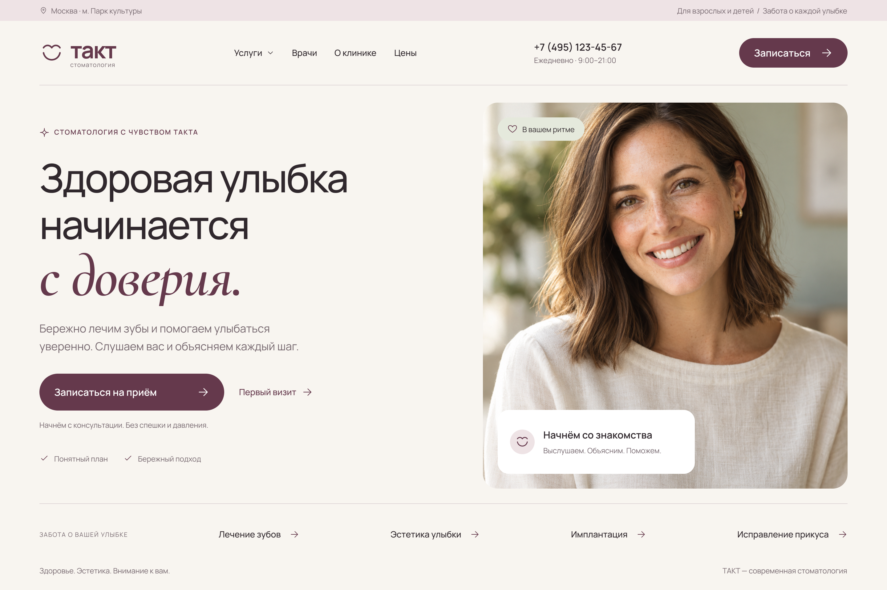
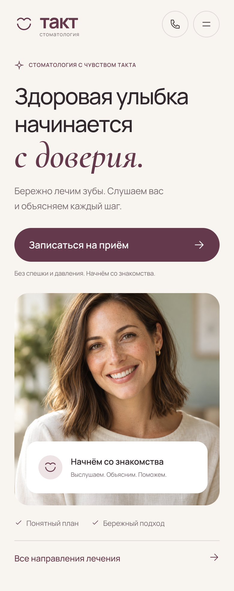

# ТАКТ — дизайн сайта стоматологической клиники

Шапка и первый экран клиники: компьютерная и мобильная версии, меню и экран записи.

[Открыть проект](https://memorim.github.io/takt-dental-landing-design/)





## Устройство проекта

Галерея макетов на HTML/CSS и экспорты изображений. Сайт можно обслуживать статическим HTTP-сервером. Сборка приложения и настройка секретов не требуются.

## Локальный запуск и проверки

Python 3.12.14, как в CI.

```bash
python tests/check_assets.py
python .github/scripts/check_docs.py
python -m http.server 8080 --bind 127.0.0.1
```

Откройте `http://localhost:8080`. CI проверяет ссылки на файлы, наличие изображений и документацию. Макеты внутри PNG/SVG не становятся интерактивными от запуска галереи.

## Границы реализации

Запись к врачу и серверная обработка заявок не подключены. Элементы внутри изображений служат для просмотра дизайна.

База данных, миграции и API в текущем варианте не используются.

[Технические сведения](docs/TECHNICAL.md) · [Выполненные проверки](docs/VERIFICATION.md) · [История изменений](CHANGELOG.md)
