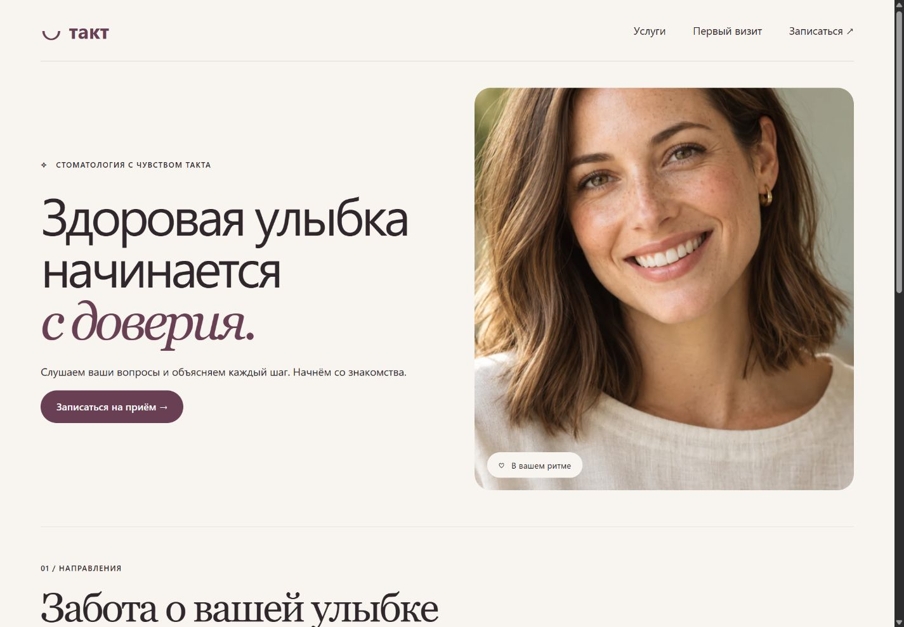
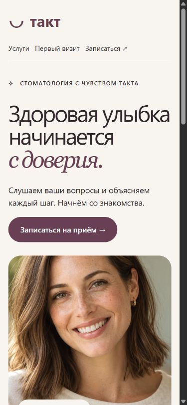

# ТАКТ · Стоматология

[Открыть сайт](https://memorim.github.io/takt-dental-landing-design/)

Скриншоты ПК и телефона обновлены 07.11.2026 с [опубликованной страницы](https://memorim.github.io/takt-dental-landing-design/). Лендинг стоматологии ТАКТ: направления лечения, первый визит и заявка на консультацию. Форма использует общий backend Cardiologist на Render, а источник обращения сохраняется как TAKT; время приёма согласуется вручную.

При изменении цветовой гаммы, вёрстки или других видимых элементов обязательно обновляйте оба скриншота в этом README — для ПК и телефона. Снимайте интерфейс после загрузки шрифтов и изображений; не включайте токены, данные клиентов и платежей.

Посетитель оставляет контакт и время для связи. Владелец проекта получает заявки в закрытой таблице `appointment_requests` в Neon. Колонка `site` для этого сайта — `takt`. Колонка `handled` позволяет отмечать обработанные обращения. Форма подтверждает получение заявки после записи в PostgreSQL. Время визита согласуется отдельно.

Статический лендинг на GitHub Pages отправляет заявку в [сервис записи](https://github.com/memorim/cardiologist-landing-designs/blob/main/server.js) на Render. Данные относятся к ТАКТ и доступны владельцу в той же закрытой базе.

[Проверка опубликованной формы 07.11.2026](docs/LIVE_INTAKE_VERIFICATION.md).
